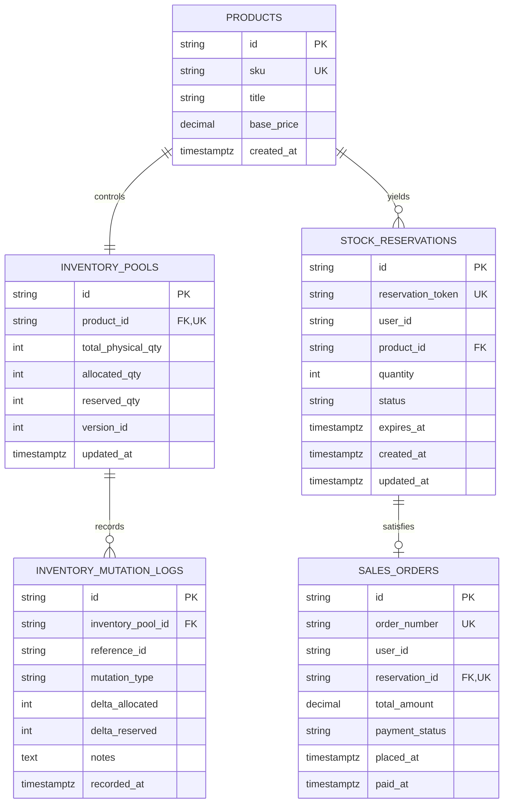

# Entity Relationship Diagram (Solusi Referensi)

Diagram di bawah ini menggambarkan alur relasi topologis dari entitas produk hingga buku besar mutasi stok pada arsitektur flash sale SysBlueprint.

